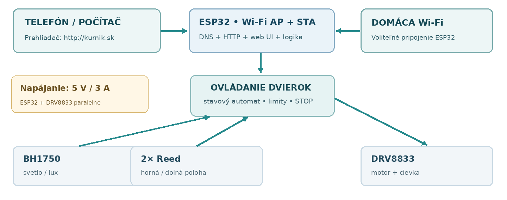

---
# 🧩 Versioning – systém dopĺňa automaticky
fm_version: "1.0.1"

# Dátum buildu – generuje skript
fm_build: "2026-11-03T15:48:24.020553+00:00"

# Poznámka k verzii – voliteľné
fm_version_comment: ""

# 🆔 IDENTITY --------------------------------------------------------

# ID generuje CLI / skript

# Unikátne UUID – generuje skript
guid: "1c0c8a63-d1dc-4b38-a36a-95baff540f96"

# 🧭 CONTEXT ---------------------------------------------------------

# DAO / doména (knife, sdlc, q12, 7ds...) dopĺňa skript
dao: "sthdf"

# Názov zápisu – dopĺňa používateľ
title: "architecture diagram"

# Krátky popis – dopĺňa používateľ (voliteľné)
description: "Bloková architektúra, sieť, DNS a pripojenie."

# 👥 AUTHORSHIP ------------------------------------------------------

# Hlavný autor – z globálneho configu
author: "Filip Chromek, Dominik Mojto, Alexander Ovšonka"

# Zoznam autorov – generuje skript
authors:
  - "Filip Chromek, Dominik Mojto, Alexander Ovšonka"

# 🗂 CLASSIFICATION ---------------------------------------------------

# Nadradená kategória – môže doplniť používateľ
category: ""

# Typ dokumentu (guide, case, tutorial...) – používateľ (voliteľné)
type: ""

# Priorita (low/medium/high) – voliteľné
priority: ""

# Tagy – odporúča sa 2–6 tagov.
# Typy tagov:
#   - rámce: knife, 7ds, sdlc, q12
#   - účel: tutorial, guide, pattern, case-study
#   - téma: git, backup, ai, communication
#   - úroveň: beginner, intermediate, advanced
tags: []

# 🌍 LOCALIZATION -----------------------------------------------------

# Jazyk dokumentu – doplní skript podľa štruktúry
locale: "sk"

# 🕒 LIFECYCLE --------------------------------------------------------

# Dátum vytvorenia – generuje skript
created: "2026-11-03 15:48"

# Dátum poslednej úpravy – dopĺňa človek
modified: "2026-11-03 15:48"

# Stav dokumentu – default "backlog"
status: "backlog"

# Viditeľnosť – default "public"
privacy: "public"

# ⚖ INTELLECTUAL PROPERTY -------------------------------------------

# Držiteľ práv k obsahu – dopĺňa skript
rights_holder_content: "Filip Chromek, Dominik Mojto, Alexander Ovšonka"

# Systémový vlastník práv
rights_holder_system: "CAA / KNIFE / LetItGrow"

# Licencia
license: "CC-BY-NC-SA-4.0"

# Disclaimer
disclaimer: "Use at your own risk. Methods provided as-is; participation is voluntary and context-aware."

# Copyright
copyright: "© 2025 Filip Chromek, Dominik Mojto, Alexander Ovšonka"

# 🔗 ORIGIN / PROVENANCE ---------------------------------------------

# Repozitár pôvodu
origin_repo: ""

# URL pôvodného repozitára
origin_repo_url: ""

# Commit pôvodu
origin_commit: ""

# Branch pôvodu
origin_branch: ""

# Systém pôvodu (CAA/KNIFE/STHDF…)
origin_system: "CAA"

# Pôvodný autor
origin_author: "Filip Chromek, Dominik Mojto, Alexander Ovšonka"

# Importovaný zdroj
origin_imported_from: ""

# Dátum importu
origin_import_date: ""

# 🧱 RESERVED ---------------------------------------------------------

fm_reserved1: ""
fm_reserved2: ""
---

<!-- SDLC_INSTANCE_ID: PRJ-6104-SmartChickenDoor -->

# 🏗️ Architecture Diagram

## 🧱 Bloková architektúra

*Obr. 2 — Sieť, riadiaca jednotka, senzory a motor. Schematická funkčná architektúra.*

Jediný regulovaný 5 V / 3 A zdroj napája v samostatných vetvách ESP32 a ovládač DRV8833. Motor je pripojený iba k ovládaču, nie priamo ku GPIO. Je nutná spoločná GND, vhodná poistka, odrušenie a overenie prúdovej špičky motora. Snímač BH1750 je pripojený cez I²C k 3,3 V logike ESP32; konkrétny modul musí túto úroveň podporovať.

Rozdelenie firmvéru na moduly je v [04 Implementation → Code Structure](../04-Implementation/code-structure.md).

## 📡 Sieťová komunikácia, DNS a pripojenie

### Režim vlastnej Wi-Fi (AP)

ESP32 vysiela sieť `KURNIK-XXXX` s WPA2/WPA3 podľa možností konkrétneho firmvéru a modulu. Poskytuje DHCP, vlastný DNS resolver a HTTP server. DNS v tejto vlastnej sieti odpovedá na `kurnik.sk` IP adresou ESP32, predvolene `192.168.4.1`. Alternatívne môže ponúknuť captive portal – otvorenie stránky nie je garantované na každom telefóne či prehliadači.

### Domáca Wi-Fi (STA) a súčasný AP+STA

V administrácii si používateľ vyberie existujúcu 2,4 GHz Wi-Fi sieť, zadá heslo a otestuje spojenie. ESP32 môže fungovať súčasne ako prístupový bod a klient (AP+STA). Po pripojení k routeru zobrazí adresu pridelenú domácou sieťou a voliteľne môže hlásiť názov `kurnik.local` cez mDNS (kompatibilita závisí od klienta). Pre stabilnú IP sa dá na routeri nastaviť DHCP rezervácia.

:::caution Limity adresy kurnik.sk
`http://kurnik.sk` je lokálny DNS alias počas pripojenia k Wi-Fi zariadenia. Na domácej Wi-Fi sa bez úpravy DNS na routeri automaticky nerozpozná; používa sa pridelená lokálna IP alebo voliteľné mDNS `kurnik.local`. HTTP presmerovanie nepremení HTTPS na funkčnú zabezpečenú stránku a automatické prechody prehliadača na HTTPS môžu spôsobiť problém. Záloha na AP: `http://192.168.4.1`.
:::

### Správanie pri strate spojenia

- Strata domácej Wi-Fi nesmie zablokovať fyzické tlačidlá ani automatiku podľa svetla.
- ESP32 sa opakovane pokúsi pripojiť na domácu sieť; po zlyhaní zachová (alebo znovu zapne) vlastný AP podľa nastavenej stratégie.
- Pri zachovanom AP sa používateľ môže vždy pripojiť priamo, upraviť heslo k routeru a vykonať diagnostiku.
- Označiť dostupnosť internetu a stav synchronizácie času; nespustiť časový alebo astronomický režim bez dôveryhodného aktuálneho času.

---
**Navigation:** [⬆️ Up](./index.md) · [🏠 Home](../index.md)
