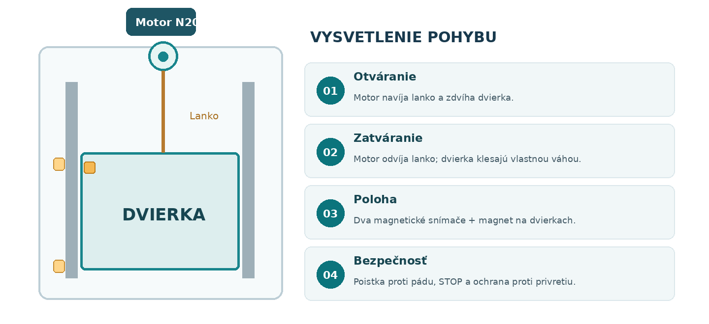

---
# 🧩 Versioning – systém dopĺňa automaticky
fm_version: "1.0.1"

# Dátum buildu – generuje skript
fm_build: "2026-11-03T15:48:24.049910+00:00"

# Poznámka k verzii – voliteľné
fm_version_comment: ""

# 🆔 IDENTITY --------------------------------------------------------

# ID generuje CLI / skript

# Unikátne UUID – generuje skript
guid: "73c9eab7-d69b-4e9f-aeeb-beaa3c5ff5b6"

# 🧭 CONTEXT ---------------------------------------------------------

# DAO / doména (knife, sdlc, q12, 7ds...) dopĺňa skript
dao: "sthdf"

# Názov zápisu – dopĺňa používateľ
title: "03 Design"

# Krátky popis – dopĺňa používateľ (voliteľné)
description: "Mechanika, snímanie polohy, BH1750 a prevádzkové režimy."

# 👥 AUTHORSHIP ------------------------------------------------------

# Hlavný autor – z globálneho configu
author: "Filip Chromek, Dominik Mojto, Alexander Ovšonka"

# Zoznam autorov – generuje skript
authors:
  - "Filip Chromek, Dominik Mojto, Alexander Ovšonka"

# 🗂 CLASSIFICATION ---------------------------------------------------

# Nadradená kategória – môže doplniť používateľ
category: ""

# Typ dokumentu (guide, case, tutorial...) – používateľ (voliteľné)
type: ""

# Priorita (low/medium/high) – voliteľné
priority: ""

# Tagy – odporúča sa 2–6 tagov.
# Typy tagov:
#   - rámce: knife, 7ds, sdlc, q12
#   - účel: tutorial, guide, pattern, case-study
#   - téma: git, backup, ai, communication
#   - úroveň: beginner, intermediate, advanced
tags: []

# 🌍 LOCALIZATION -----------------------------------------------------

# Jazyk dokumentu – doplní skript podľa štruktúry
locale: "sk"

# 🕒 LIFECYCLE --------------------------------------------------------

# Dátum vytvorenia – generuje skript
created: "2026-11-03 15:48"

# Dátum poslednej úpravy – dopĺňa človek
modified: "2026-11-03 15:48"

# Stav dokumentu – default "backlog"
status: "backlog"

# Viditeľnosť – default "public"
privacy: "public"

# ⚖ INTELLECTUAL PROPERTY -------------------------------------------

# Držiteľ práv k obsahu – dopĺňa skript
rights_holder_content: "Filip Chromek, Dominik Mojto, Alexander Ovšonka"

# Systémový vlastník práv
rights_holder_system: "CAA / KNIFE / LetItGrow"

# Licencia
license: "CC-BY-NC-SA-4.0"

# Disclaimer
disclaimer: "Use at your own risk. Methods provided as-is; participation is voluntary and context-aware."

# Copyright
copyright: "© 2025 Filip Chromek, Dominik Mojto, Alexander Ovšonka"

# 🔗 ORIGIN / PROVENANCE ---------------------------------------------

# Repozitár pôvodu
origin_repo: ""

# URL pôvodného repozitára
origin_repo_url: ""

# Commit pôvodu
origin_commit: ""

# Branch pôvodu
origin_branch: ""

# Systém pôvodu (CAA/KNIFE/STHDF…)
origin_system: "CAA"

# Pôvodný autor
origin_author: "Filip Chromek, Dominik Mojto, Alexander Ovšonka"

# Importovaný zdroj
origin_imported_from: ""

# Dátum importu
origin_import_date: ""

# 🧱 RESERVED ---------------------------------------------------------

fm_reserved1: ""
fm_reserved2: ""
---

<!-- SDLC_INSTANCE_ID: PRJ-6104-SmartChickenDoor -->

# 03 Design

Návrh architektúry, dátového modelu a používateľského rozhrania.

- 🏗️ [Architektúra, sieť a komunikácia](./architecture-diagram.md)
- 🗃️ [Dátový model – konfigurovateľné parametre](./data-model.md)
- 🎨 [Návrh obrazoviek webového rozhrania](./ui-mockups.md)

## ⚙️ Mechanika a snímanie polohy

*Obr. 1 — Koncepcia dvierok, lanka a snímačov; nie je to montážny výkres.*

Motor s prevodovkou zdvihne dvierka navíjaním lanka. Pri spúšťaní lanko kontrolovane odvíja a dvierka klesajú gravitáciou. Pevné vedenie, zádržná poistka vo vrchnej polohe a možnosť mechanického núdzového otvorenia sú povinné časti návrhu.

### Detekcia otvorenia a zatvorenia

Preferovaná verzia používa jeden magnet na pohyblivých dvierkach a dva magnetické Reed kontakty na ráme (hore a dole). Senzory sú pripojené na digitálne vstupy ESP32 so správnymi pull-up/pull-down odpormi. Ako lacná alternatíva sú možné dva mechanické koncové spínače. Snímanie samotného motora by nebolo dostatočné, pretože pri uvoľnení lanka nemusí zodpovedať skutočnej polohe dvierok.

| Horný snímač | Dolný snímač | Interpretácia |
|---|---|---|
| **1** | 0 | OTVORENÉ |
| **0** | 1 | ZATVORENÉ |
| **0** | 0 | MEDZIPOLOHA alebo poloha neznáma – rozlíšiť podľa prebiehajúceho príkazu |
| **1** | 1 | PORUCHA: nepravdepodobná kombinácia; okamžitý STOP |

### Požiadavky na pohon a bezpečnosť

- Motor N20 5–6 V s prevodovkou a navíjacou cievkou (orientačne 15–20 mm) musí mať dostatočný pracovný krútiaci moment pri napájaní 5 V.
- Dvierka nesmú po vypnutí motora samovoľne spadnúť. Bežná čelná prevodovka N20 nemusí byť samosvorná: treba overiť brzdenie alebo doplniť zarážku, západku či iný bezpečný zádržný mechanizmus.
- Dvierka, držiak motora a lišty sa vytlačia najmä z PETG/ASA; dbať na vlhkosť, špinu, námrazu a nízke trenie.
- Automatický pohyb musí mať STOP, časový limit a fyzicky overenú ochranu proti privretiu. Detekcia koncovej polohy nie je ochranou zvieraťa pri zatváraní.

## 💡 Svetelný senzor BH1750

BH1750 je digitálny snímač osvetlenia, ktorý prenáša údaje cez I²C a poskytuje hodnotu v luxoch (lx). Má význam pre rozhodovanie o svitaní a súmraku. Snímač nebude fungovať ako solárny zdroj energie; na napájanie zariadenia sa používa adaptér.

| Parameter | Návrh / pravidlo |
|---|---|
| **Napájanie** | 3,3 V a GND z ESP32; I²C SDA/SCL na vhodných GPIO, často napr. GPIO21/22 pri klasickom ESP32 DevKit. |
| **Miesto montáže** | Vonku alebo na mieste s denným svetlom; chrániť pred dažďom, priamym umelým svetlom a nečistotami. |
| **Vzorkovanie** | Napr. každých 10 s, s filtrovaním krátkych výkyvov a indikáciou chyby komunikácie. |
| **Otvárací prah** | Samostatný nastaviteľný prah v luxoch; otvárací prah musí byť vyšší než zatvárací. |
| **Zatvárací prah** | Samostatný nižší prah v luxoch; podmienka musí trvať dlhší čas bez prerušenia. |
| **Oneskorenie** | Napr. potvrdenie ráno 10 min a večer 15 min; iba východiskové hodnoty na kalibráciu. |
| **Strata senzora** | Zobraziť chybu, nespoliehať sa na poslednú starú hodnotu; automatické zatváranie podľa svetla nevykonať naslepo. |

:::info Kalibrácia svetla
Odporúčané prahy nie sú univerzálne. Používateľ ich nastaví podľa skutočných hodnôt nameraných na konkrétnom kuríne. Do webu zaradiť „aktuálne luxy“, vizualizáciu a test prahov.
:::

## 🔄 Prevádzkové režimy a priority

| Režim | Podmienka otvorenia | Podmienka zatvorenia |
|---|---|---|
| **MANUÁLNY** | Iba príkaz používateľa alebo lokálne tlačidlo. | Iba príkaz používateľa alebo lokálne tlačidlo. |
| **ČASOVÝ** | Pri dosiahnutí nastaveného času, ak je systémový čas platný. | Pri dosiahnutí druhého nastaveného času; každá udalosť najviac raz za deň. |
| **SLNKO** | Východ slnka vypočítaný podľa polohy + nastaviteľný posun. | Západ slnka vypočítaný podľa polohy + nastaviteľný posun. |
| **SVETLO** | Luxy nad otváracím prahom neprerušene aspoň nastavený čas. | Luxy pod zatváracím prahom neprerušene aspoň nastavený čas. |

### Hysteréza, oneskorenia a opakované príkazy

V svetelnom režime musí byť otvárací prah väčší než zatvárací, aby pri oblačnosti nevznikalo cyklické otváranie/zatváranie. Softvér má zaznamenať, že denná alebo večerná udalosť už prebehla, a zabrániť okamžitej zmene smeru po malej fluktuácii svetla. Hodnoty 10 min ráno a 15 min večer sú východiskový návrh na testovanie, nie pevná vlastnosť senzora.

### Manuálny zásah a STOP

Manuálny príkaz spustený z webu dočasne preruší automatiku. Predvolene sa obnoví pri najbližšej plánovanej udalosti až po bezpečnom potvrdení používateľovi; voliteľne zostane režim MANUÁLNY až do explicitného obnovenia. Najvyššiu prioritu má bezpečnostný STOP, potom fyzický núdzový STOP, potom bezpečný manuálny príkaz a až následne automatický harmonogram.

### Poruchy a výpadky

- **Neplatný čas:** neaktivovať ČAS ani SLNKO; SVETLO a manuálne ovládanie môžu fungovať, ak sú senzory a mechanika v poriadku.
- **Chyba BH1750:** zastaviť automatické rozhodovanie v režime SVETLO; zobraziť chybu a stav posledného merania ako neplatný.
- **Nepravdepodobné signály oboch snímačov polohy:** zastaviť motor a vyžadovať kontrolu.
- **Zaseknutie alebo nedosiahnutie polohy v limite:** STOP, stav PORUCHA, nezapínať motor opakovane bez zásahu.
- **Reset počas pohybu:** motory pri reštarte vypnuté; až potom kontrola senzorov a opätovné povolenie akcie.
- **Strata domácej Wi-Fi:** zachovať lokálne ovládanie a svetelnú automatiku; opakované pripojenie nesmie reštartovať aktuálny pohyb.

---
**Navigation:** [⬆️ Up](../index.md) · [🏠 Home](../index.md)
